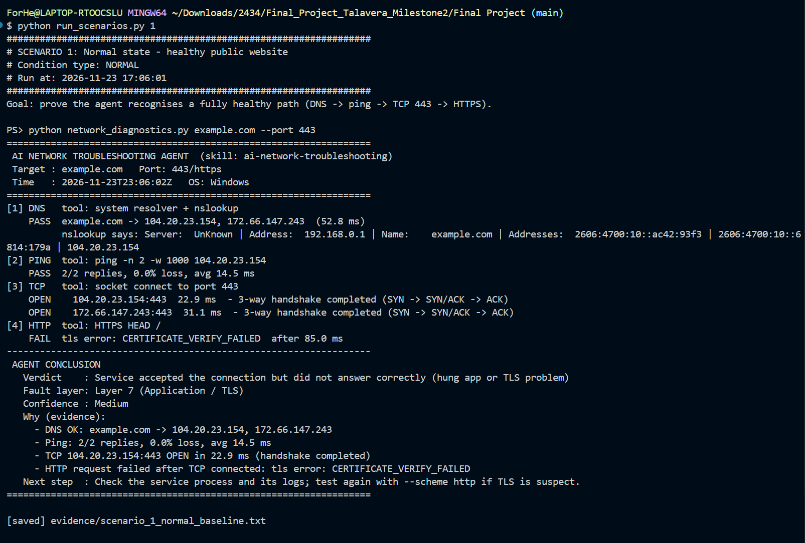
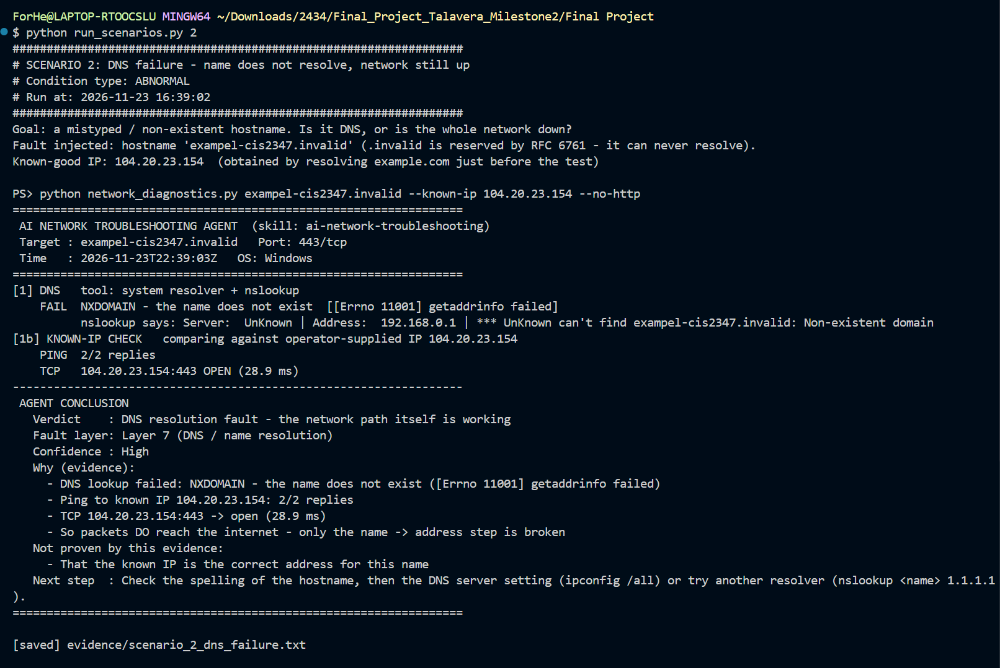
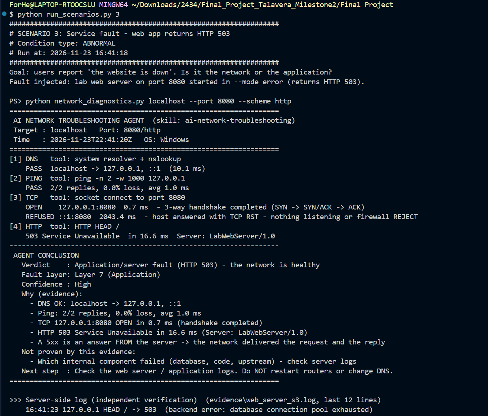
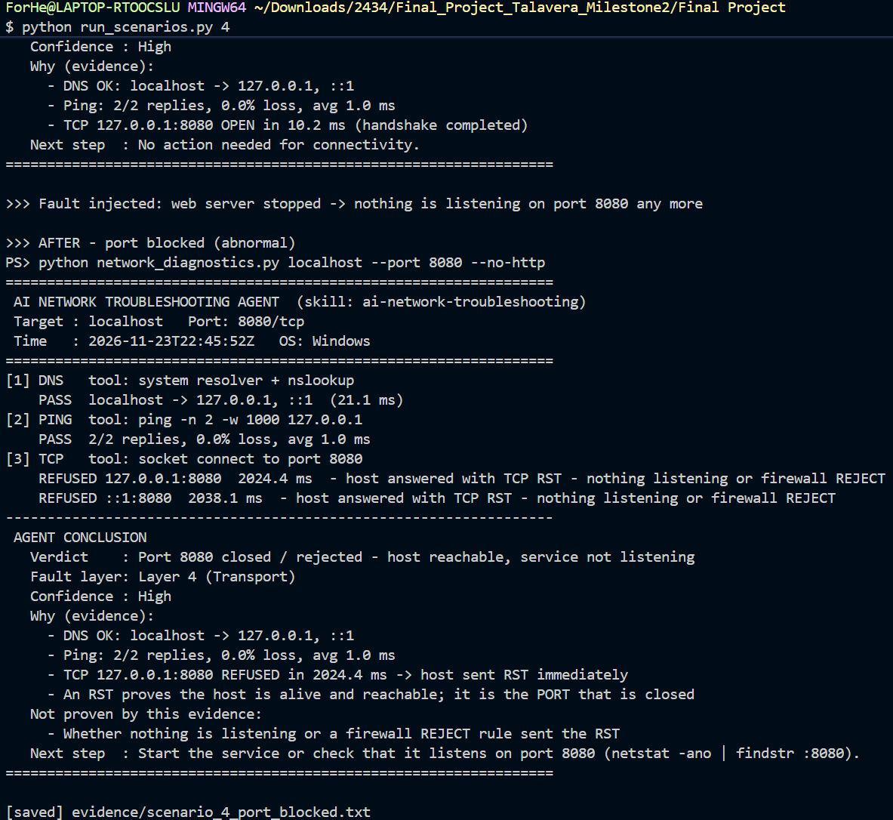
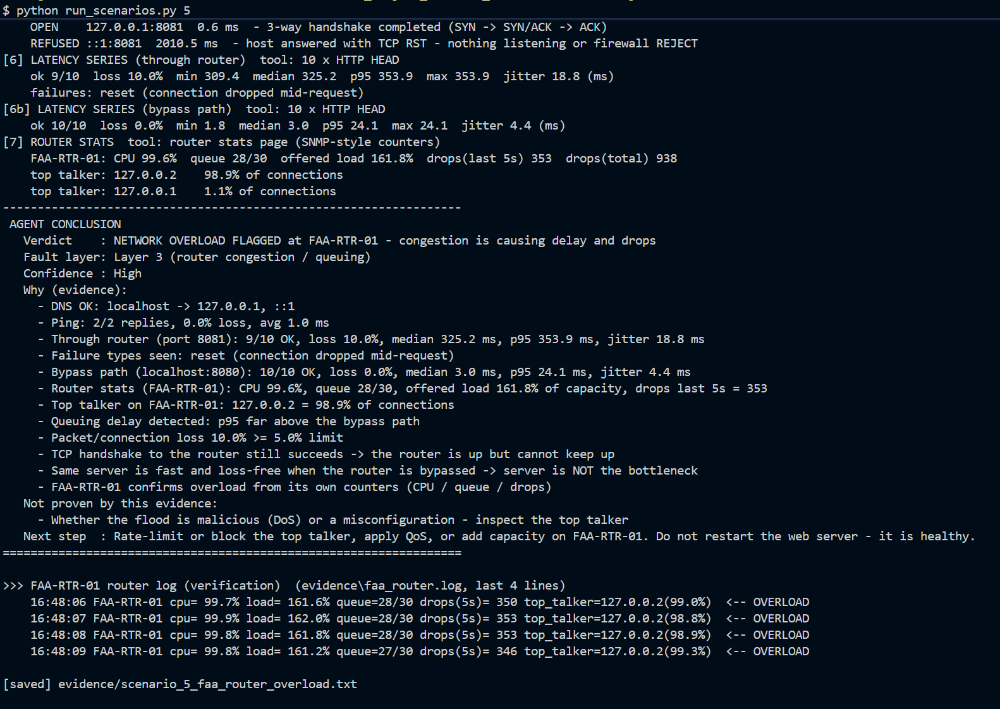
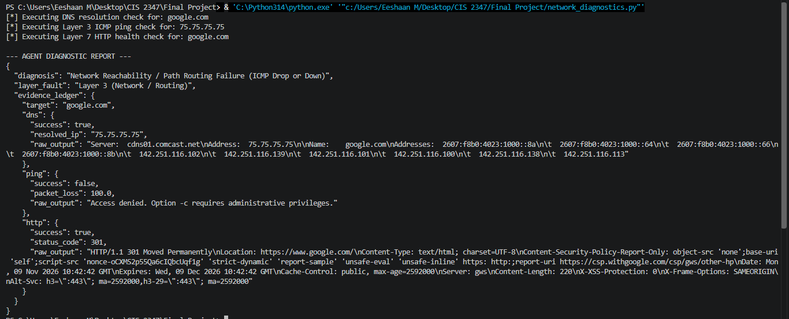

# AI Network Troubleshooting Agent — Milestone 2

## Team information

**Project title:** AI Network Troubleshooting Agent
**Course:** CIS 2347, University of Houston

| Team member | Contribution to Milestone 2 |
|---|---|
| **Eeshaan Momin** | Found and fixed the two Milestone 1 bugs: Windows `ping -c` and the nslookup parsing error. Rewrote the agent CLI. Updated the `ai-network-troubleshooting` skill to v2. Ran and analyzed Scenarios 1 and 2. Wrote the report. |
| **Antonio Talavera** | Built the lab used for fault injection: the 503 web server, the FAA-RTR-01 router simulator and the traffic flood generator. Wrote the `router-overload-detection` skill. Ran and analyzed Scenarios 3–5. Checked each agent conclusion against server and router logs. |

---

## 1. At a glance

| # | Scenario | Condition | What we broke | Tools the agent used | Agent's verdict | Correct? |
|---|---|---|---|---|---|---|
| 1 | Healthy website | **Normal** | Nothing | DNS, ping, TCP, HTTP | Healthy, all layers OK | ✅ |
| 2 | Misspelled hostname | **Abnormal** | Name that can't exist (`.invalid`) | DNS, nslookup, ping, TCP | DNS fault, network still works | ✅ |
| 3 | Website "down" | **Abnormal** | Web app returns HTTP 503 | DNS, ping, TCP, HTTP + server log | Application fault, network healthy | ✅ |
| 4 | Port blocked | **Normal → Abnormal** | Web service stopped, so port 8080 closes | DNS, ping, TCP | Before: port open · After: port closed, host still up | ✅ |
| 5 | **FAA router overload** | **Normal → New / unseen** | Flood of traffic into FAA-RTR-01 | TCP, repeated timing test, direct-path test, router stats | Before: healthy · After: **overload flagged at FAA-RTR-01** | ✅ |

**Main idea:** the agent never decides from a single tool. Each verdict comes from comparing tools at different layers. For example, when ping fails but HTTP works, ICMP is being filtered and the host is up. When the router path is slow but the bypass path is fast, the router is the bottleneck.

---

## 2. How the test lab works (VS Code only)

Everything runs from the VS Code terminal on Windows. It needs no Linux, no admin rights and no installs. Faults are created safely:

```
Scenario 1-2 :  agent ──► internet (example.com)            real public site
Scenario 3   :  agent ──► lab web server :8080 (503 mode)   127.0.0.1 only
Scenario 4   :  agent ──► lab web server :8080  (running, then stopped)
Scenario 5   :  agent ──► FAA-RTR-01 :8081 ──► web server :8080
                  └──── direct (skips router) ──► web server :8080
                traffic_flood.py ══► FAA-RTR-01   (overload)
```

Scenarios 4 and 5 each show a **before (normal)** and an **after (abnormal)** run, so the change is easy to see.

One command runs any scenario and saves the evidence automatically:

```powershell
python run_scenarios.py 1     # 1 to 5, or "all"
```

### What changed in the Skill since Milestone 1

| Change | Reason |
|---|---|
| `ping -n` on Windows instead of `ping -c` | `-c` needs admin on Windows, so ping always "failed" (see §8) |
| DNS answer taken from the system resolver; `nslookup` kept as raw evidence | The old parser read the DNS **server's** IP as the website's IP |
| TCP/HTTP success now overrides a ping failure | ICMP is often blocked even when the host is up |
| Connection failures sorted by type (refused vs timed out) | How a connection fails shows why it failed |
| New `router-overload-detection` skill | Needed to detect congestion, which a single probe cannot see |

---

## 3. Scenario 1 — Normal state (baseline)

**Question:** Can the agent recognize a fully healthy path?
**Command:** `python network_diagnostics.py example.com --port 443`

**Evidence:**



**Agent result:** Healthy. All layers were verified.

**Analysis & verification:**
- Each tool checks a different layer. DNS gave an address (L7 naming), ping got echo replies (L3), TCP finished the SYN → SYN/ACK → ACK handshake (L4), and HTTPS returned 200 (L7).
- The HTTPS check **validates the TLS certificate for example.com**, so we reached the real server and not just some machine at that IP.
- Cross-check: `Invoke-WebRequest https://example.com -Method Head` also returns `StatusCode 200`, which matches Milestone 1.
- **Correct ✅.** The agent also says what this does *not* prove: future availability, or that every resolved IP works. example.com runs behind a CDN, so the IP can change between runs.

---

## 4. Scenario 2 — DNS failure (abnormal)

**Question:** A user typed the wrong name. Is DNS broken, or the whole network?
**Fault:** `exampel-cis2347.invalid`. The `.invalid` domain is reserved (RFC 6761) and can never resolve, so we know the correct answer in advance.
**Command:** `python network_diagnostics.py exampel-cis2347.invalid --known-ip 104.20.23.154 --no-http`

**Evidence:**



**Agent result:** DNS fault. The network path works.

**Analysis & verification:**
- **NXDOMAIN vs timeout matters.** NXDOMAIN means the DNS server *answered* and said the name does not exist, so the DNS server is reachable and working. A timeout would mean the resolver itself is unreachable, which needs a different fix.
- The known IP answers ping and completes a TCP handshake, so routing and transport are fine. Only the name → address step failed.
- **Correct ✅.** This matches the ground truth because `.invalid` never resolves. The agent also notes it cannot prove the known IP is the right address for the misspelled name.

---

## 5. Scenario 3 — Service fault (abnormal)

**Question:** Users say "the website is down". Is it the network or the app?
**Fault:** lab web server started with `--mode error`, which returns **HTTP 503**.
**Command:** `python network_diagnostics.py localhost --port 8080 --scheme http`

**Evidence:**



**Agent result:** Application fault. The network is healthy.

**Analysis & verification:**
- An HTTP 503 can only exist if the request reached the server and the reply came back. That proves DNS, IP routing and TCP all worked.
- The **server log**, which the agent never reads, independently confirms the cause: a backend database problem.
- **Correct ✅.** The agent avoids a common mistake: restarting routers or blaming DNS when the problem is inside the application.

---

## 6. Scenario 4 — Port blocked (normal → abnormal)

**Question:** The web service stops. Can the agent tell "the port is closed" from "the network is down"?
**What we did:** ran the agent once with the web server running, then stopped the server and ran it again.
**Command (both times):** `python network_diagnostics.py localhost --port 8080 --no-http`

**Evidence:**



```text
##################################################################
# SCENARIO 4: Port blocked - web service stops listening on its port
# Condition type: NORMAL -> ABNORMAL
# Run at: 2026-11-23 16:52:36
##################################################################
Goal: the web service on port 8080 stops. Can the agent tell 'port closed' from 'network down'?

>>> BEFORE - service running (normal)
PS> python network_diagnostics.py localhost --port 8080 --no-http
==================================================================
 AI NETWORK TROUBLESHOOTING AGENT  (skill: ai-network-troubleshooting)
 Target : localhost   Port: 8080/tcp
 Time   : 2026-11-23T22:52:37Z   OS: Windows
==================================================================
[1] DNS   tool: system resolver + nslookup
    PASS  localhost -> 127.0.0.1, ::1  (10.5 ms)
[2] PING  tool: ping -n 2 -w 1000 127.0.0.1
    PASS  2/2 replies, 0.0% loss, avg 1.0 ms
[3] TCP   tool: socket connect to port 8080
    OPEN    127.0.0.1:8080  1.4 ms  - 3-way handshake completed (SYN -> SYN/ACK -> ACK)
    REFUSED ::1:8080  2022.3 ms  - host answered with TCP RST - nothing listening or firewall REJECT
------------------------------------------------------------------
 AGENT CONCLUSION
   Verdict    : Port 8080 is reachable - transport layer healthy
   Fault layer: Layer 4 (Transport) OK
   Confidence : High
   Why (evidence):
     - DNS OK: localhost -> 127.0.0.1, ::1
     - Ping: 2/2 replies, 0.0% loss, avg 1.0 ms
     - TCP 127.0.0.1:8080 OPEN in 1.4 ms (handshake completed)
   Next step  : No action needed for connectivity.
==================================================================

>>> Fault injected: web server stopped -> nothing is listening on port 8080 any more

>>> AFTER - port blocked (abnormal)
PS> python network_diagnostics.py localhost --port 8080 --no-http
==================================================================
 AI NETWORK TROUBLESHOOTING AGENT  (skill: ai-network-troubleshooting)
 Target : localhost   Port: 8080/tcp
 Time   : 2026-11-23T22:52:42Z   OS: Windows
==================================================================
[1] DNS   tool: system resolver + nslookup
    PASS  localhost -> 127.0.0.1, ::1  (19.9 ms)
[2] PING  tool: ping -n 2 -w 1000 127.0.0.1
    PASS  2/2 replies, 0.0% loss, avg 1.0 ms
[3] TCP   tool: socket connect to port 8080
    REFUSED 127.0.0.1:8080  2042.7 ms  - host answered with TCP RST - nothing listening or firewall REJECT
    REFUSED ::1:8080  2035.7 ms  - host answered with TCP RST - nothing listening or firewall REJECT
------------------------------------------------------------------
 AGENT CONCLUSION
   Verdict    : Port 8080 closed / rejected - host reachable, service not listening
   Fault layer: Layer 4 (Transport)
   Confidence : High
   Why (evidence):
     - DNS OK: localhost -> 127.0.0.1, ::1
     - Ping: 2/2 replies, 0.0% loss, avg 1.0 ms
     - TCP 127.0.0.1:8080 REFUSED in 2042.7 ms -> host sent RST immediately
     - An RST proves the host is alive and reachable; it is the PORT that is closed
   Not proven by this evidence:
     - Whether nothing is listening or a firewall REJECT rule sent the RST
   Next step  : Start the service or check that it listens on port 8080 (netstat -ano | findstr :8080).
==================================================================

[saved] evidence/scenario_4_port_blocked.txt

```

**Agent result:** Before: port open. After: port closed, but the host is still reachable.

**Analysis & verification:**
- Ping still works and DNS still works, so the computer and the network are fine.
- The TCP test got **REFUSED**, which means the computer sent back a **RST (reset)**: "nobody is listening on this port". If the network were down, there would be no reply at all and the test would end in a **timeout** instead.
- **Unexpected Windows behavior:** the refusal took about **2 seconds** (2042.7 ms), not a fraction of a millisecond. Windows doesn't give up after the first reset. It retries the connection twice more before reporting "refused". So on Windows the *type* of error (refused vs. timed out) is the evidence, not the speed. The agent's line "host sent RST immediately" is therefore slightly inaccurate (see §8).
- The `::1` lines are IPv6. `localhost` resolves to both 127.0.0.1 (IPv4) and ::1 (IPv6), and our lab server only listens on IPv4. That's why `::1` is refused even in the BEFORE run, while 127.0.0.1 is OPEN.
- Cross-check: `netstat -ano | findstr :8080` shows nothing listening after the server is stopped.
- **Correct ✅.** The agent blames the port (Layer 4), not the network, and suggests restarting the service.

---

## 7. Scenario 5 — FAA router overloading the network (normal → new / unseen)

**Question:** Users say "the network is slow". Can the agent find the cause and flag the router?
**Setup:** traffic goes through **FAA-RTR-01**, a simulated router. We tested it normally, then sent it more traffic than it can handle (`traffic_flood.py`) and tested again.
**Command (both times):**

```powershell
python network_diagnostics.py localhost --port 8081 --scheme http --samples 10 `
       --bypass localhost:8080 --router-stats http://127.0.0.1:8082/stats
```

`--samples 10` repeats the request 10 times, `--bypass` also tests the server directly (skipping the router), and `--router-stats` reads the router's own counters.

**Evidence:**



| What we measured | Before (normal) | After (overloaded) |
|---|---|---|
| Delay through FAA-RTR-01 (median) | 17 ms | **325 ms** |
| Delay going directly to the server (median) | 15 ms | 3 ms (still fast) |
| Requests that failed through the router | 0 of 10 | **1 of 10 (reset)** |
| Router CPU | 4 % | **99.6 %** |
| Packets dropped by the router (last 5 s) | 0 | **353** |
| Agent verdict | Healthy | **Overload flagged at FAA-RTR-01** |

```text
##################################################################
# SCENARIO 5: FAA-RTR-01 router overload - congestion flagged
# Condition type: NORMAL -> NEW / UNSEEN
# Run at: 2026-11-23 16:47:45
##################################################################
Goal: users say 'the network is slow'. Can the agent find and flag the overloaded router?
Path:  agent --> FAA-RTR-01 (:8081) --> web server (:8080)

>>> BEFORE - FAA-RTR-01 normal (no extra traffic)
PS> python network_diagnostics.py localhost --port 8081 --scheme http --samples 10 --bypass localhost:8080 --router-stats http://127.0.0.1:8082/stats
==================================================================
 AI NETWORK TROUBLESHOOTING AGENT  (skill: ai-network-troubleshooting)
 Target : localhost   Port: 8081/http
 Time   : 2026-11-23T22:47:48Z   OS: Windows
==================================================================
[1] DNS   tool: system resolver + nslookup
    PASS  localhost -> 127.0.0.1, ::1  (8.6 ms)
[2] PING  tool: ping -n 2 -w 1000 127.0.0.1
    PASS  2/2 replies, 0.0% loss, avg 1.0 ms
[3] TCP   tool: socket connect to port 8081
    OPEN    127.0.0.1:8081  1.3 ms  - 3-way handshake completed (SYN -> SYN/ACK -> ACK)
    REFUSED ::1:8081  2031.8 ms  - host answered with TCP RST - nothing listening or firewall REJECT
[6] LATENCY SERIES (through router)  tool: 10 x HTTP HEAD
    ok 10/10  loss 0.0%  min 15.4  median 16.8  p95 27.3  max 27.3  jitter 2.4 (ms)
[6b] LATENCY SERIES (bypass path)  tool: 10 x HTTP HEAD
    ok 10/10  loss 0.0%  min 3.2  median 15.2  p95 26.6  max 26.6  jitter 12.7 (ms)
[7] ROUTER STATS  tool: router stats page (SNMP-style counters)
    FAA-RTR-01: CPU 3.9%  queue 0/30  offered load 2.2%  drops(last 5s) 0  drops(total) 0
    top talker: 127.0.0.1    100.0% of connections
------------------------------------------------------------------
 AGENT CONCLUSION
   Verdict    : Path through FAA-RTR-01 is healthy - no congestion detected
   Fault layer: None
   Confidence : High
   Why (evidence):
     - DNS OK: localhost -> 127.0.0.1, ::1
     - Ping: 2/2 replies, 0.0% loss, avg 1.0 ms
     - Through router (port 8081): 10/10 OK, loss 0.0%, median 16.8 ms, p95 27.3 ms, jitter 2.4 ms
     - Bypass path (localhost:8080): 10/10 OK, loss 0.0%, median 15.2 ms, p95 26.6 ms, jitter 12.7 ms
     - Router stats (FAA-RTR-01): CPU 3.9%, queue 0/30, offered load 2.2% of capacity, drops last 5s = 0
     - Top talker on FAA-RTR-01: 127.0.0.1 = 100.0% of connections
     - Delay and loss are inside normal limits (loss < 5.0%, p95 < bypass + 100 ms)
   Not proven by this evidence:
     - Behaviour under heavier load (this is a point-in-time baseline)
   Next step  : Keep this as the baseline for later comparison.
==================================================================

>>> Fault injected: flood of traffic sent into FAA-RTR-01 (more than it can handle)

>>> AFTER - FAA-RTR-01 overloaded
PS> python network_diagnostics.py localhost --port 8081 --scheme http --samples 10 --bypass localhost:8080 --router-stats http://127.0.0.1:8082/stats
==================================================================
 AI NETWORK TROUBLESHOOTING AGENT  (skill: ai-network-troubleshooting)
 Target : localhost   Port: 8081/http
 Time   : 2026-11-23T22:47:59Z   OS: Windows
==================================================================
[1] DNS   tool: system resolver + nslookup
    PASS  localhost -> 127.0.0.1, ::1  (10.5 ms)
[2] PING  tool: ping -n 2 -w 1000 127.0.0.1
    PASS  2/2 replies, 0.0% loss, avg 1.0 ms
[3] TCP   tool: socket connect to port 8081
    OPEN    127.0.0.1:8081  0.6 ms  - 3-way handshake completed (SYN -> SYN/ACK -> ACK)
    REFUSED ::1:8081  2010.5 ms  - host answered with TCP RST - nothing listening or firewall REJECT
[6] LATENCY SERIES (through router)  tool: 10 x HTTP HEAD
    ok 9/10  loss 10.0%  min 309.4  median 325.2  p95 353.9  max 353.9  jitter 18.8 (ms)
    failures: reset (connection dropped mid-request)
[6b] LATENCY SERIES (bypass path)  tool: 10 x HTTP HEAD
    ok 10/10  loss 0.0%  min 1.8  median 3.0  p95 24.1  max 24.1  jitter 4.4 (ms)
[7] ROUTER STATS  tool: router stats page (SNMP-style counters)
    FAA-RTR-01: CPU 99.6%  queue 28/30  offered load 161.8%  drops(last 5s) 353  drops(total) 938
    top talker: 127.0.0.2    98.9% of connections
    top talker: 127.0.0.1    1.1% of connections
------------------------------------------------------------------
 AGENT CONCLUSION
   Verdict    : NETWORK OVERLOAD FLAGGED at FAA-RTR-01 - congestion is causing delay and drops
   Fault layer: Layer 3 (router congestion / queuing)
   Confidence : High
   Why (evidence):
     - DNS OK: localhost -> 127.0.0.1, ::1
     - Ping: 2/2 replies, 0.0% loss, avg 1.0 ms
     - Through router (port 8081): 9/10 OK, loss 10.0%, median 325.2 ms, p95 353.9 ms, jitter 18.8 ms
     - Failure types seen: reset (connection dropped mid-request)
     - Bypass path (localhost:8080): 10/10 OK, loss 0.0%, median 3.0 ms, p95 24.1 ms, jitter 4.4 ms
     - Router stats (FAA-RTR-01): CPU 99.6%, queue 28/30, offered load 161.8% of capacity, drops last 5s = 353
     - Top talker on FAA-RTR-01: 127.0.0.2 = 98.9% of connections
     - Queuing delay detected: p95 far above the bypass path
     - Packet/connection loss 10.0% >= 5.0% limit
     - TCP handshake to the router still succeeds -> the router is up but cannot keep up
     - Same server is fast and loss-free when the router is bypassed -> server is NOT the bottleneck
     - FAA-RTR-01 confirms overload from its own counters (CPU / queue / drops)
   Not proven by this evidence:
     - Whether the flood is malicious (DoS) or a misconfiguration - inspect the top talker
   Next step  : Rate-limit or block the top talker, apply QoS, or add capacity on FAA-RTR-01. Do not restart the web server - it is healthy.
==================================================================

>>> FAA-RTR-01 router log (verification)  (evidence\faa_router.log, last 4 lines)
    16:48:06 FAA-RTR-01 cpu= 99.7% load= 161.6% queue=28/30 drops(5s)= 350 top_talker=127.0.0.2(99.0%)  <-- OVERLOAD
    16:48:07 FAA-RTR-01 cpu= 99.9% load= 162.0% queue=28/30 drops(5s)= 353 top_talker=127.0.0.2(98.8%)  <-- OVERLOAD
    16:48:08 FAA-RTR-01 cpu= 99.8% load= 161.8% queue=28/30 drops(5s)= 353 top_talker=127.0.0.2(98.9%)  <-- OVERLOAD
    16:48:09 FAA-RTR-01 cpu= 99.8% load= 161.2% queue=27/30 drops(5s)= 346 top_talker=127.0.0.2(99.3%)  <-- OVERLOAD

[saved] evidence/scenario_5_faa_router_overload.txt

```

**Agent result:** Before: healthy. After: **overload flagged at FAA-RTR-01**.

**Analysis & verification:**
- **The router is the slow part.** Through the router the delay went from 17 ms to 325 ms, and 1 of 10 requests was dropped. Going straight to the server stayed fast (3 ms) with no failures. So the server is fine and the delay is added inside FAA-RTR-01.
- **Why it slows down:** the router can handle 100 connections per second but received about 160. The extra traffic waits in line (a queue). When the line is full, the router throws packets away, which is why it dropped 353 in 5 seconds.
- **The math checks out:** 30 packets waiting × 10 ms each ≈ 300 ms of waiting, and we measured 325 ms. The extra ~25 ms is normal request time on Windows (the baseline was already 15–17 ms).
- **Verified by the router's own log:** CPU at ~100%, a nearly full queue (28/30), and the flood source (127.0.0.2) sending about 99% of the traffic.
- **Correct ✅.** The agent flags the router, doesn't blame the web server, and points to the source of the extra traffic.

---

## 8. Limitations and improvements

### Incorrect conclusion we found (Milestone 1 code)



Running the Milestone 1 agent on `google.com` gave **"Network Reachability / Path Routing Failure — Layer 3"**. That was wrong, because the same run got **HTTP 301** from Google, which proves the path worked. There were two bugs:

1. **Wrong IP:** the regex took the first `Address:` line, and that line is the DNS **server** (75.75.75.75, Comcast), not Google.
2. **Fake ping failure:** `ping -c 2` on Windows returned *"Option -c requires administrative privileges"*. The agent read the error as 100% packet loss.

**Fix:** `ping -n` on Windows, a reliable DNS lookup, and a new rule that a working TCP/HTTP connection overrides a ping failure. Fed the same evidence, the v2 agent now says *"Healthy … (ICMP filtered)"*.
**Lesson:** a tool error is not a network measurement. The agent must check whether the tool actually ran.

### Other limitations

| Limitation | Effect | Improvement |
|---|---|---|
| Unexpected: in Scenario 5 only 1 of our 10 test requests was dropped, while the router dropped ~40% of the flood traffic | The flood sent far more packets, so it took most of the drops. 10 samples is too few to measure loss precisely | More samples, or several requests at once |
| Unexpected: on Windows a refused connection took ~2 s (Scenario 4) | The agent says "RST immediately", which isn't true on Windows. The verdict is still correct because it is based on the error type | Reword the agent message; rely on refused vs. timeout, not timing |
| `localhost` also resolves to IPv6 `::1`, but the lab server only listens on IPv4 | Extra "REFUSED ::1" lines in Scenarios 4–5 that could confuse a reader | Make the lab server listen on both IPv4 and IPv6 |
| A stopped service and a firewall REJECT rule both send a reset (Scenario 4) | The agent can't say which one caused it | Check `netstat` for a listener, or capture packets with Wireshark |
| Fixed thresholds (5% loss, +100 ms) | Could misjudge links that are naturally slow, such as satellite | Compare against a saved baseline per network |
| Lab runs on one PC (loopback) | No real cables, Wi-Fi or WAN latency | Test against a real lab router (GNS3, Packet Tracer) with real SNMP |
| FAA-RTR-01 and its stats are simulated | Real routers report through SNMP/NetFlow | Read real SNMP counters (ifInDiscards, CPU) |
| Only the first open IP and one HTTP request are tested | CDN/anycast sites can behave differently per IP | Test all resolved IPs |
| `tracert` is slow (~20 s) and `*` hops are ambiguous | Slow demos; possible false alarms | Trace only when ping and TCP both fail (already done) |
| Windows counts "Destination host unreachable" as *Received* | Could have caused a false "ping OK" | Handled: only replies containing `TTL=` count |

---

## 9. How to reproduce

```powershell
cd "Final Project"
python run_scenarios.py all
```

Evidence files are written to `evidence/scenario_1_*.txt` through `scenario_5_*.txt`, plus the server and router logs. See `README.md` for details.
